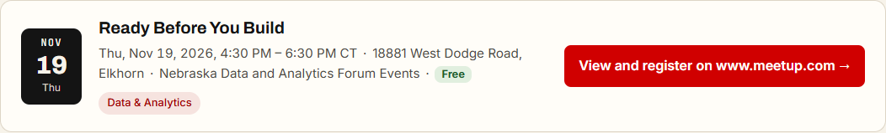
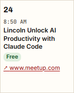

# Checkpoint: cost signifier (FR-052)

**Date:** 2026-10-23 (America/Chicago)
**Task:** T162
**Result:** **Partly passed; T162 stays open.** Checked on the live site
(https://netechconnect.pages.dev, deploy of `654495b`) in Microsoft Edge, scripted with
Playwright: 6 of 6 checks passed. The third case in the task, a cost the event page itself
states, is not live yet (see below).

> **Later the same day (T163):** the owner removed the cost label from cards and calendar
> entries, since a "Free" label on some events would suggest the others cost money. Cost now
> shows only as the Cost row on the event page. The card and calendar results below record
> what was live before that change.

## How the events got there

1. PR #77 (T161) set `default_cost: free` on nine sources the owner knows are free.
2. A manual discover-events run read the new probationary sources; their events were held.
3. Review PR #79: the owner approved 15 and rejected 16 (Digital Lincoln's event, which is in
   Lincoln, England, and the makerspace's welding, pumpkin-carving and lumber classes).
   Apply review published the decisions in #80.

## Results

| Check | Result |
|---|---|
| `/data/upcoming.json` | 20 events: 4 `cost: free` with `cost` in `inferred` (from the source default), 16 `cost: null` |
| List: cards for the 4 free events | Each shows a green **Free** pill (screen readers: "Cost: Free") |
| List: the other 16 cards | No cost label |
| Calendar, October 2026 | **Free** on the 3 free entries that month |
| Event page, *Ready Before You Build* | A **Cost: Free** row, and the note "The topics, time zone and cost were worked out by NETechConnect, not stated by the organizer." |
| Event page, Kernelcon (unknown cost) | No Cost row |

## Still to check

- **A cost the event page states.** (NE)NUG's page says `isAccessibleForFree: true`, but the
  source was not due on this run, so its stored event has no cost yet. Check again after the
  next scheduled run that reads it: the (NE)NUG event should show **Free** with no
  "worked out" note. Then tick T162.

## Found along the way

- **The "worked out" note's wording.** With three items it read "topics and time zone and
  cost"; it now reads "topics, time zone and cost" (same PR as this record).
- **Digital Lincoln is in England.** Meetup gives its events `addressCountry: gb` and region
  `H7`, but "Lincoln" matched Lincoln, NE. The event was rejected in review. The place matcher
  should drop listings whose country isn't the US, and the source should be paused or removed.
