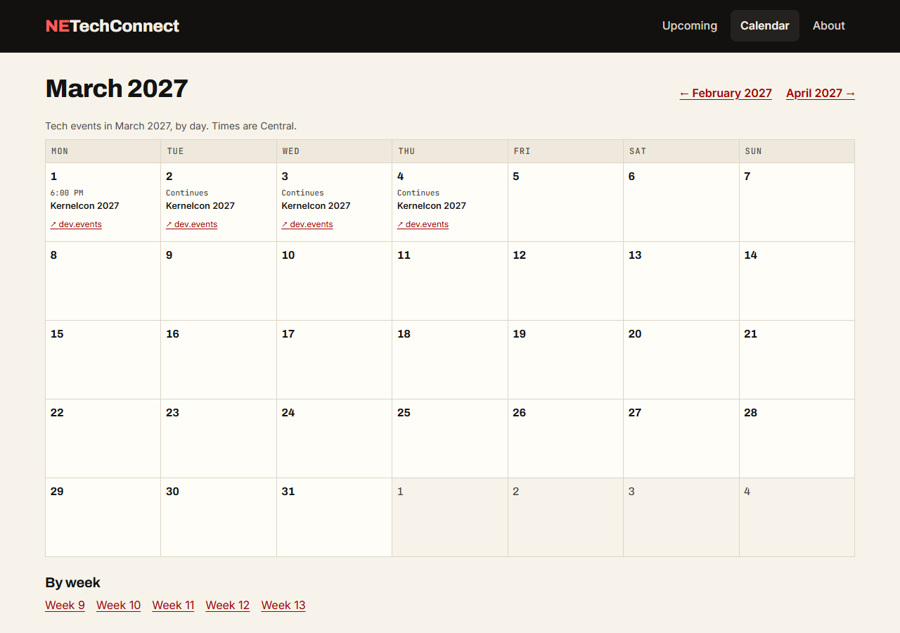
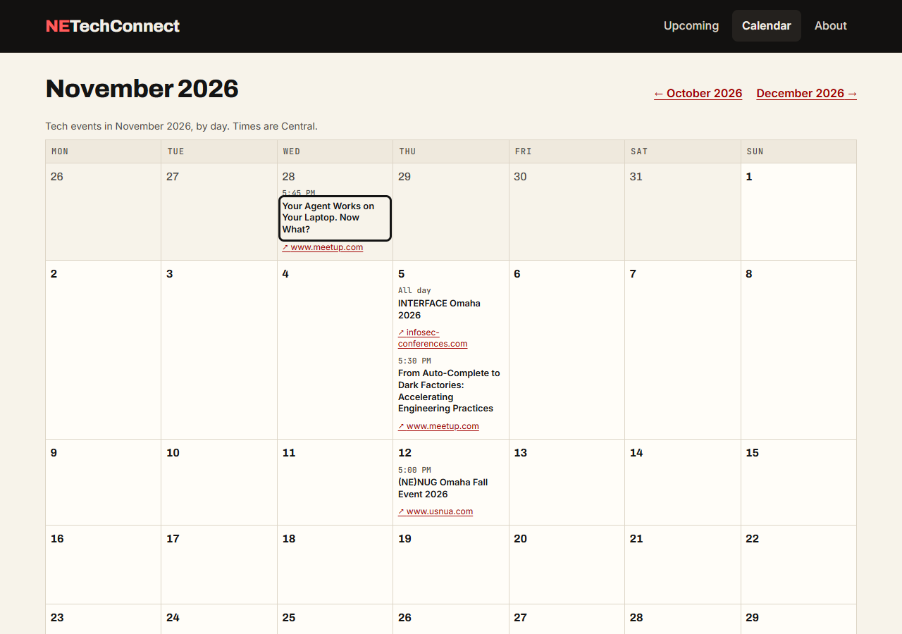

# Checkpoint: US3 (Phase 5), the calendar

**Date:** 2026-10-23 (America/Chicago; times below are UTC)
**Task:** T110
**Result:** **Passed**, with one small fix. Quickstart scenario 3 was run against the live site
(https://netechconnect.pages.dev, deploy of `adbbe5d` at 16:04) in Microsoft Edge, scripted
with Playwright, including a keyboard-only pass: 23 of 25 checks passed first time. One failure
was in the check itself; the other was a real layout problem on phones, now fixed and covered
by a test.

## Scenario 3 on the live site

| Expected | Result |
|---|---|
| `/calendar/` opens the current month | Redirected to `/calendar/2026/10/` (October in Central Time) |
| Each event is on its Central Time day | All 5 upcoming events from `/data/upcoming.json` are on exactly their Central Time days, on both the month and the week page |
| A multi-day event spans its days | **Kernelcon 2027** (Mar 1 6 PM – Mar 4 6 PM CT) is on all four days, Mar 1–4, in March 2027 and week 9 |
| Two events on one day | Nov 5: INTERFACE Omaha 2026 (all day) and the AI Omaha talk (5:30 PM), in that order |
| Previous and next work | Clicked: October → November → October; week 45 → 46 → 45 |
| Events open from the calendar | Each event links to its page and to the organizer's page (`rel="noopener external"`) |

## Keyboard only (November 2026)

| Check | Result |
|---|---|
| The first Tab reaches the skip link | "Skip to main content" |
| The skip link works | Enter moves focus to `<main>` |
| Every stop shows a focus indicator | All 23 focusable elements show the 3 px outline |
| The order follows the page | Skip link, brand, Upcoming, **Calendar**, About, ← October 2026, December 2026 →, then each event: its page, then its organizer, day by day |
| Shift+Tab goes back | From the first event back to "December 2026 →" |
| Links open with Enter | Enter on "December 2026 →" opens December; Enter on the first event opens its page ("Your Agent Works on Your Laptop. Now What?") |

The first scripted run reported one stop without a focus indicator. It was the check: after the
23rd Tab, focus leaves the page for `<body>`, which has no outline. Every focusable element has
one.

## Fixed: the phone agenda showed another month's days

On a phone (under 600 px) a month is a stacked list of the days that have events. The November
grid starts on Mon Oct 26, and the Oct 28 talk is in that leading row, so the November list on a
phone began with "Wed, Oct 28". The list now shows only the month's own days (`is-other-month`
cells are hidden there too); the wide grid still shows them, dimmed.

## Now covered by tests

`web/tests/calendar.spec.js` (Playwright, runs in CI) keeps these checks:

- the skip link is the first stop and moves focus to the content;
- every focusable element on a month page shows a focus outline;
- the next-month link and an event open with the keyboard alone;
- on a phone, the month lists only its own days, each with an event.

These add to the build tests (T107: tables, captions, headings, days, links, range), the unit
tests (T106: Central Time days, DST, multi-day and past-midnight events) and axe-core on a month
and a week page (WCAG 2.2 AA, including target size).
