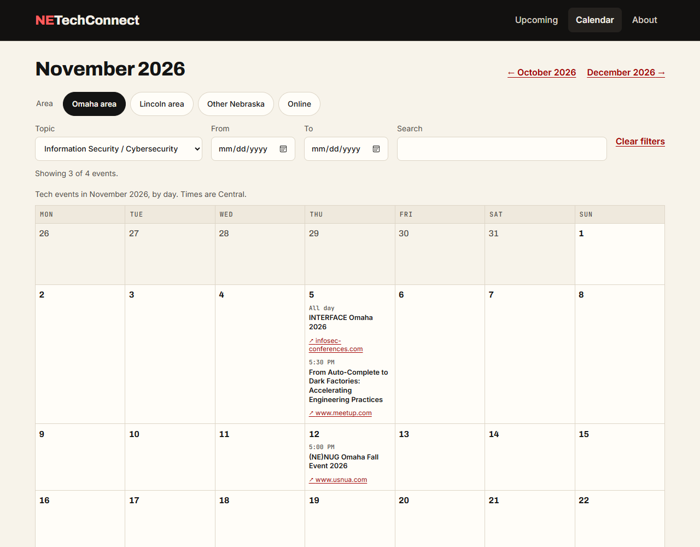
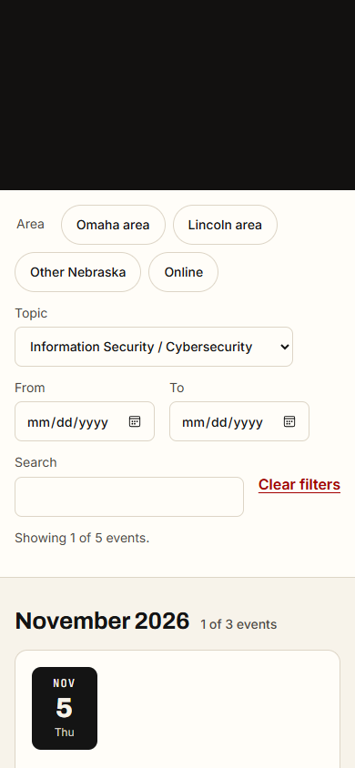

# Checkpoint: US4 (Phase 6), filters

**Date:** 2026-10-23 (America/Chicago; times below are UTC)
**Task:** T114
**Result:** **Passed.** Quickstart scenario 4 was run against the live site
(https://netechconnect.pages.dev, deploy of `0bb8402`) in Microsoft Edge, scripted with
Playwright: 15 of 15 checks passed. The expected events for each filter were worked out
independently from the live `/data/upcoming.json` and compared with what the page showed.

## The live data

All five upcoming events were in the Omaha area, so the scenario as written
(`area=lincoln&cat=security,ai-ml`) correctly matches none, and the other cases below exercise
the filters with events that do match.

| Day (CT) | Area | Topics | Event |
|---|---|---|---|
| Oct 28 | omaha | cloud-devops | Your Agent Works on Your Laptop. Now What? |
| Nov 5 | omaha | security, networking-infra | INTERFACE Omaha 2026 |
| Nov 5 | omaha | ai-ml | From Auto-Complete to Dark Factories |
| Nov 12 | omaha | ai-ml, networking-infra | (NE)NUG Omaha Fall Event 2026 |
| Mar 1–4, 2027 | omaha | general-tech | Kernelcon 2027 |

## On the list

| Address | Expected | Shown, and the status line |
|---|--:|---|
| `/?area=lincoln&cat=security,ai-ml` (the scenario) | 0 | 0, "No events match these filters." |
| `/?area=omaha` | 5 | 5, "Showing 5 of 5 events." |
| `/?cat=security` | 1 | 1, "Showing 1 of 5 events." |
| `/?cat=ai-ml&area=omaha` | 2 | 2 |
| `/?from=2026-11-01&to=2026-11-30` | 3 | 3 |
| `/?from=2027-03-02&to=2027-03-02` (inside Kernelcon's four days) | 1 | 1 |
| `/?q=omaha` | 5 | 5 |
| `/?area=mars&cat=bogus&from=2026-13-45` (all invalid) | 5 | 5: ignored |

## Across views, and a reload

Starting from `/?area=omaha&cat=security,ai-ml`:

| Step | Result |
|---|---|
| Nav → Calendar | `/calendar/2026/10/?area=omaha&cat=security,ai-ml` (straight to the current month, filters kept) |
| Next month | `/calendar/2026/11/?area=omaha&cat=security,ai-ml` |
| Calendar entries | Only the three matching events (INTERFACE, the AI Omaha talk, (NE)NUG) |
| Reload | The same three; Omaha checked |
| Nav → Upcoming | `/?area=omaha&cat=security,ai-ml` |

## Keyboard, phone, no JavaScript

- **Keyboard:** Tab to the first area chip and press Space: the list and the address change to
  `?area=omaha`, and the status line is updated (it is a `role="status"` region, so screen
  readers announce it).
- **Phone:** the filter bar stacks above the list; month headings read "1 of 3 events".
- **JavaScript off:** all five events show, the form stays hidden, and the page carries the
  `<noscript>` notice "Filters need JavaScript".

## Notes

- **Several topics in one link:** `cat=security,ai-ml` applies both topics, but the Topic menu
  can show only one, so it shows the first ("Information Security / Cybersecurity"). Choosing a
  topic in the menu then replaces both with that one. A multi-select or topic chips would show
  both; left as is for now.
- These checks are also in CI against a fixture site (`web/tests/filters.spec.js`, T111).
