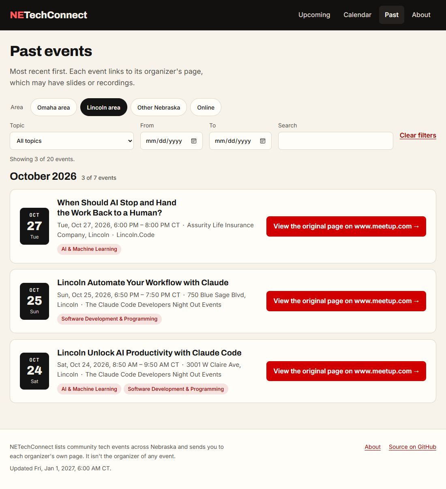
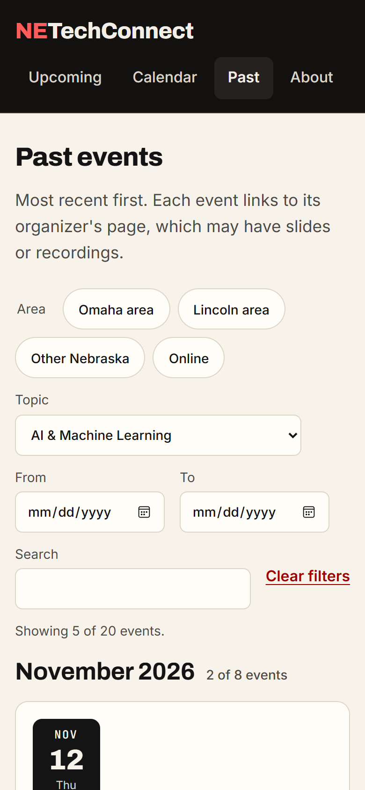

# Checkpoint: US5 (Phase 7), past events

**Date:** 2026-10-23 (America/Chicago)
**Task:** T119
**Result:** **Passed.** Quickstart scenario 5 was run on today's real data, rebuilt "as of"
2027-01-01 12:00 UTC (`netc build-site --now 2027-01-01T12:00:00Z`, from `main` at `bdebefe`),
served locally and checked in Microsoft Edge with Playwright: **27 of 27 checks passed**. The
expected results were worked out independently, from the raw `data/events/` files rather than
the built site. The live site was also checked.

## The data, as of Jan 1, 2027

Of today's 21 published events, 20 have ended by then; only Kernelcon 2027 (March) is still
upcoming. The 20 past events run from Oct 21 to Dec 29, 2026: 16 in the Omaha area (12 of them
Made New Makerspace's weekly "Open House & Community Hangout"), 3 in Lincoln, 1 elsewhere.

To check the "may no longer be available" note (US5 scenario 3), the scratch copy of the data
had one event marked `original_unavailable` (the Dec 29 Open House). Nothing in `data/` was
changed.

## Results

| # | Check | Result |
|---|---|---|
| 1 | Upcoming list | Only Kernelcon 2027 |
| 2 | `/past/` | All 20 ended events, most recent first, under December, November and October 2026 headings; one page (the 50-per-page split is covered by the build tests) |
| 3 | Filters on `/past/` | All 7 cases matched, with the status line: `area=omaha` 16 · `area=lincoln` 3 · `cat=ai-ml` 5 · `cat=security,ai-ml&area=omaha` 4 · `from=2026-11-01&to=2026-11-30` 8 · `q=claude` 2 · all-invalid values ignored, 20 |
| 4 | Across views | `/past/?area=omaha` → Calendar (`/calendar/2027/01/?area=omaha`) → previous month → Upcoming → Past: the filter was kept at every step |
| 5 | Past cards | Link to the original page with "View the original page on groups.drupal.org" (no registration wording); the event's own page still exists |
| 6 | Calendar | November 2026 still shows its 8 events |
| 7 | Public data | `/data/past/2026.json` holds the 20 events, most recent first; no other years |
| 8 | Gone original page | "The original page may no longer be available." on that event's card (only there) and on its event page |
| 9 | Accessibility and phone | axe: no violations on `/past/` in light and dark; at 390 px wide the page doesn't scroll sideways |

## On the live site

`/past/` is live (deploy of `bdebefe`) with the **Past** link in the main nav. It shows the one
published event that has ended so far (Drupal Nebraska, Oct 21), with "View the original page
on groups.drupal.org", and `/data/past/2026.json` is published.

## Notes

- **The monthly link check (T118)** runs for real on Nov 1. Its first run report will have a
  "Past events' original pages" line; the 404/410 detection itself is covered by
  `tests/unit/test_linkcheck.py` and the discover-events integration tests.
- **Recurring events fill the archive.** Weekly makerspace open houses are 12 of the 20 past
  events. That's accurate, but if the archive gets noisy, grouping a series (the `series_key`
  in the data model) would help.
- **Building on Windows:** an output folder with a long path can push long event slugs past
  Windows' 260-character limit; the build here used a short temporary folder. CI (Linux) isn't
  affected.
