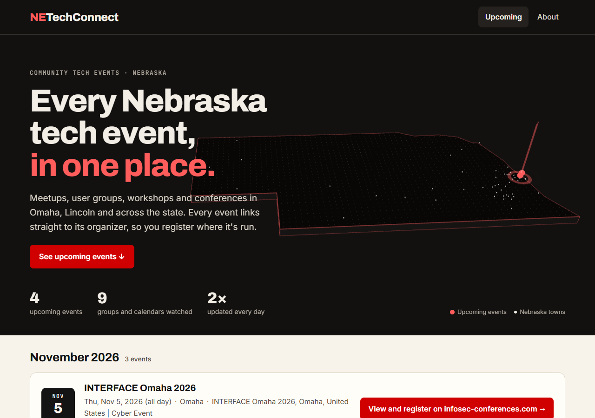
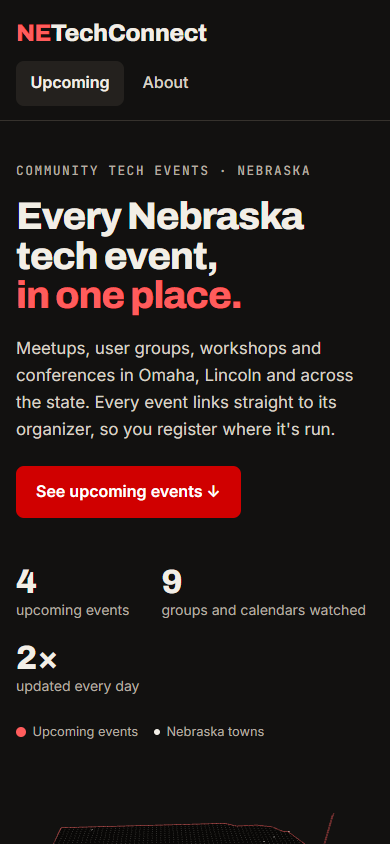
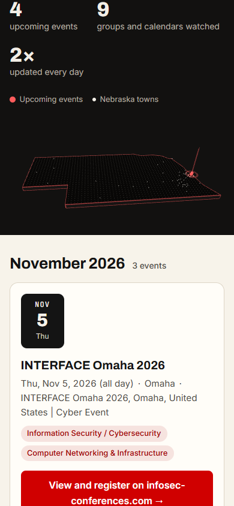

# Design B review (T155)

Checkpoint for design direction B (research R15; tasks T150–T155): the self-hosted type, the
restyle, and the decorative three.js map in the home page header. SC-006 asks that the main
content shows within 2 seconds on a phone, with the map.

## Lighthouse, mobile (Oct 22, 2026)

Lighthouse 13.5.0, default mobile settings (simulated slow 4G and a 4× slower CPU, Moto G-sized
screen), run 3 times against the live site, https://netechconnect.pages.dev/, after the phone
map change (#60) was deployed. three.js loaded in every run, so these are the numbers **with the
map**.

| Run | Performance | FCP | LCP | TBT | CLS | Speed Index |
|---|--:|--:|--:|--:|--:|--:|
| 1 | 94 | 1.3 s | 1.9 s | 270 ms | 0.007 | 1.4 s |
| 2 | 94 | 1.3 s | 1.7 s | 270 ms | 0.007 | 1.4 s |
| 3 | 94 | 1.3 s | 1.7 s | 260 ms | 0 | 1.4 s |
| **Median** | **94** | **1.3 s** | **1.7 s** | **270 ms** | **0.007** | **1.4 s** |

**SC-006: passes.** The largest contentful paint is the intro paragraph (text, not the map), at
1.7 s median; the slowest run was 1.9 s, so the margin is small.

Other categories: accessibility **100**, best practices **96**. The only best-practices finding
was a console error for `/favicon.ico` (404 on every page; the site never had one). This review
adds a 1.7 KB favicon.

**What the map costs:** three.js is 143 KB transferred and starts downloading only after the page
has loaded (about 0.4–0.6 s into the simulated load). Building the scene is the biggest script
cost on the slowed CPU (about 1.5 s of work, mostly after the content is shown) and most of the
270 ms Total Blocking Time. If a later page pushes LCP past 2 s, the first thing to try is
starting the map later (for example, only when the header is in view and the browser is idle for
longer).

## Real phone check

*To do (owner):* open https://netechconnect.pages.dev/ on your phone and note:

- [ ] The headline and intro appear quickly, before the map.
- [ ] The map animates (it sits in its own row under the counts; scroll a little if needed).
- [ ] Scrolling stays smooth with the map on screen.
- [ ] With the phone's reduce-motion setting on, the map is still.
- [ ] Phone model and browser: …

## Screenshots

Before: the site at the start of Oct 22 (commit 1c008af), built from that day's data. After: the
live site with design B.

| | Before | After |
|---|---|---|
| Desktop (1280 px) |  |  |
| Phone (390 px) |  |  |

The phone's map, a short scroll down: 

## Follow-ups found during the review

- **Organizer names from page titles.** One card's organizer reads "INTERFACE Omaha 2026, Omaha,
  United States | Cyber Event": the source was named from a page title. Discovery should clean
  these up (or the review queue should catch them).
- **"Next up" card.** Not built yet: it belongs to the first page without the map (T109 or T117).
